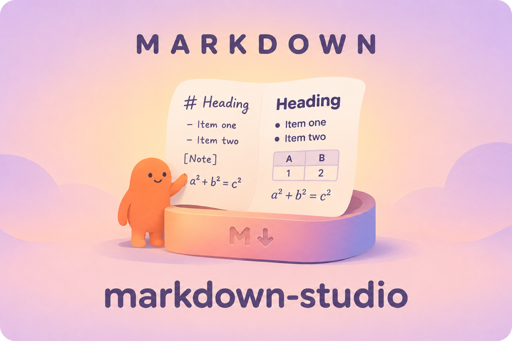
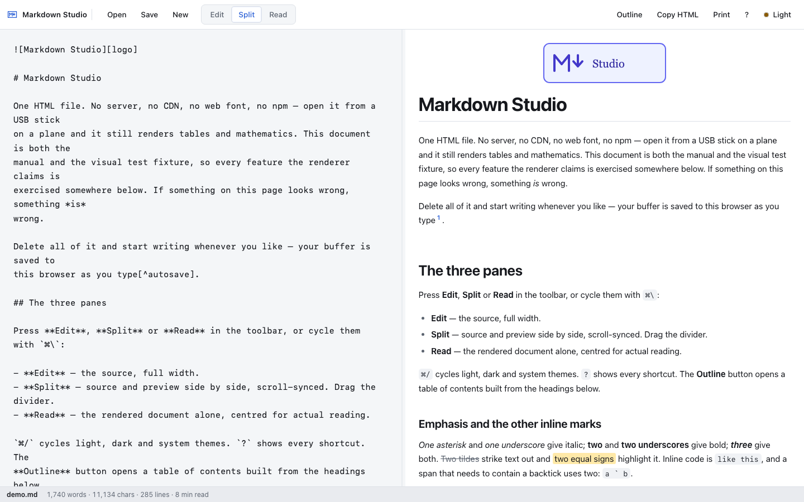
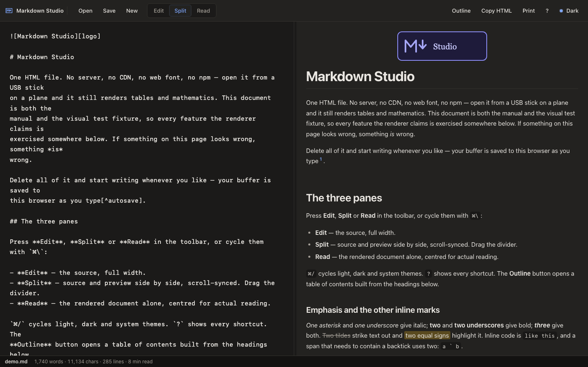
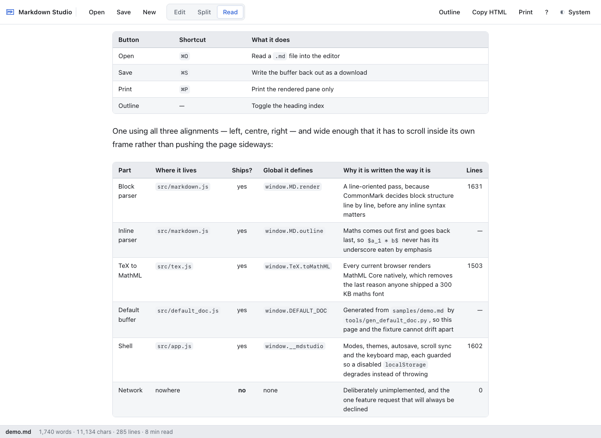
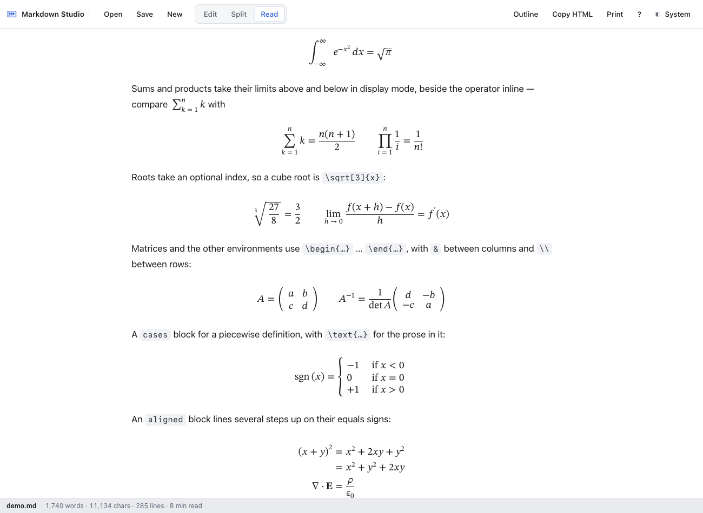

<!--
GitHub metadata — authored here, applied by hand in repo Settings (NOT rendered on the page):
About:  Read, edit & typeset Markdown offline — a 1 MB native macOS app on system WebKit, or the same 238 KB single HTML file, with GFM tables & LaTeX compiled to native MathML.
Topics (ranked): markdown-editor, markdown, markdown-viewer, macos-app, latex, mathml, commonmark, gfm, markdown-parser, offline-first, single-file, zero-dependencies, vanilla-js, swift, dark-mode, math-rendering, macos
Social preview: docs/media/hero.png is the 1536x1024 source; the card is
  derived, never committed —
    python Tools/image_compress.py docs/media/hero.png 1MB --glass
  then upload docs/media/hero-glass.jpg in Settings > Social preview.
  See GitHub/docs/image-processing.md.
-->

# markdown-studio — Offline Markdown Reader & Editor

**One HTML file — or a native Mac app. Tables, LaTeX, dark mode. No internet.**  
*A hand-written Markdown renderer and TeX-to-MathML compiler inlined into a single self-contained page — open it from `file://` with the network unplugged and it still typesets mathematics, or download the 1 MB Mac app and double-click your `.md` files.*


[](https://github.com/AdinathChaudhari/markdown-studio/releases/latest)

<p align="center">
  
</p>

<table>
<tr>
<td></td>
<td></td>
</tr>
<tr><td align="center"><sub>Light</sub></td><td align="center"><sub>Dark</sub></td></tr>
</table>

Most Markdown editors are an Electron install or a web app that phones home. This is one
238 KB `.html` file: a CommonMark + GFM parser, a TeX-to-MathML compiler and the editor
shell, concatenated into a single page with no CDN, no web font and no npm package. Copy it
to a USB stick and it works on a machine that has never seen the internet.

On a Mac you can skip the browser entirely: the same file ships inside a native app that uses
the system's built-in WebKit and measures about 100–126 MB of memory with a document open.

## The map

| I want to… | Where | What it is |
|---|---|---|
| **Just read** a `.md` file | [`markdown-studio.html`](markdown-studio.html) | Double-click it, then drop your file on the window |
| **Use it as a Mac app** | [Releases](https://github.com/AdinathChaudhari/markdown-studio/releases/latest) | Download the DMG, drag to Applications, double-click any `.md` — see [macOS app](#macos-app) |
| **Edit** with a live preview | `Split` mode, <kbd>⌘\\</kbd> | Source and render side by side, scroll-synced, draggable divider |
| **Write mathematics** | `$…$` and `$$…$$` | Compiled to native MathML by [`src/tex.js`](src/tex.js) |
| **Flip the theme** | <kbd>⌘/</kbd> | Light, dark, or follow the OS — remembered across reloads |
| **Change the code** | [`build.py`](build.py) | Re-inlines everything under [`src/`](src/) back into the one file |

## Quick start

```bash
git clone https://github.com/AdinathChaudhari/markdown-studio.git
open markdown-studio/markdown-studio.html      # or just double-click it
```

1. **Read** the page that loads — it is the manual and the test fixture at once.
2. **Open** your own file with <kbd>⌘O</kbd>, or drag it anywhere onto the window.
3. **Press** <kbd>?</kbd> for every shortcut.

**On a Mac?** Download `MarkdownStudio-<version>.dmg` from [Releases](https://github.com/AdinathChaudhari/markdown-studio/releases/latest) instead — setup steps are in [macOS app](#macos-app).

That is the whole install — no build, no dependencies, nothing to configure. Everything
below is detail.

---

## Demo

Tables keep their alignment, scroll inside their own frame when they are too wide, and
carry inline code, links and math in cells:



LaTeX is compiled to MathML Core, which every current browser renders natively — stretchy
fences, limits above and below, matrices and `cases`, with no maths font downloaded:



Building it and checking it are one command each:

```
$ python3 build.py
built markdown-studio.html (234.0 KB, no external requests)

$ node --test tests/*.mjs
ℹ pass 212
ℹ fail 0

$ python3 tests/browser_smoke.py
test_no_external_requests ... ✓
test_tables_render ... ✓
test_math_elements_are_painted ... ✓
test_theme_button_cycles_and_repaints ... ✓
Ran 12 tests in 11.6s
OK
```

---

## How it works

Three globals, concatenated in a fixed order into one `<script>`. `app.js` reads the other
two, so it comes last — that order is behaviour, not style.

| Part | Source | Global | Lines |
|---|---|---|---|
| **Markdown parser** | [`src/markdown.js`](src/markdown.js) | `MD.render` | 1631 |
| **TeX compiler** | [`src/tex.js`](src/tex.js) | `TeX.toMathML` | 1503 |
| **Editor shell** | [`src/app.js`](src/app.js) | `__mdstudio` | 1611 |
| **Styling** | [`src/theme.css`](src/theme.css) + [`app.css`](src/app.css) + [`markdown.css`](src/markdown.css) | design tokens | 1573 |

Two decisions do most of the work:

1. **Math is extracted before anything else.** `$a_1 * b$` would otherwise lose its
   underscore and asterisk to the emphasis pass. Formulas are lifted out to placeholder
   tokens up front, masked against code spans and fences, and substituted back at the very
   end — so a `$` in a code block is never math and `$5 and $10` stays a price.
2. **MathML instead of a maths font.** MathML Core is rendered natively by Safari, Chrome
   109+, Edge and Firefox, which removes the only real reason to ship KaTeX or MathJax and
   the 300 KB font that comes with them.

## Keyboard

| Key | Does |
|---|---|
| <kbd>⌘O</kbd> / <kbd>⌘S</kbd> | Open a file / save the buffer back out |
| <kbd>⌘P</kbd> | Print the rendered pane alone, or export it as PDF |
| <kbd>⌘\\</kbd> | Cycle edit / split / read |
| <kbd>⌘/</kbd> | Cycle light / dark / system |
| <kbd>⌘⇧O</kbd> | Toggle the outline |
| <kbd>⌘B</kbd> / <kbd>⌘I</kbd> / <kbd>⌘K</kbd> | Bold, italicise or link the selection |
| <kbd>Tab</kbd> / <kbd>⇧Tab</kbd> | Indent or outdent the selected lines |
| <kbd>Enter</kbd> | Continue a list, task item or blockquote |
| <kbd>?</kbd> | Show every shortcut |

`Ctrl` replaces `⌘` off macOS. The help sheet is generated from the same table the handlers
read, so it cannot drift out of date.

> **Your buffer lives in this browser, not in the HTML file.** Typing autosaves to
> `localStorage`, so the same file opened in another browser — or on another machine — starts
> from the shipped document. Press <kbd>⌘S</kbd> to write a real `.md` you can move around.

---

## Build and test

Editing anything under `src/` needs a rebuild; nothing else does.

```bash
python3 build.py                    # inlines src/ into markdown-studio.html
node --test tests/*.mjs             # 212 tests: parser + TeX compiler
python3 tests/browser_smoke.py      # 12  tests: the built file really loads
python3 tests/mathml_render.py      # 25  tests: MathML paints a non-zero box
python3 tests/test_ui.py            # 32  tests: the app as a user drives it
```

281 tests, no network, no credentials, about 75 seconds. The build needs only Python 3; the
three browser suites additionally need `pip install playwright && playwright install
chromium`.

Pass the glob, not the directory — `node --test tests/` fails with `MODULE_NOT_FOUND`,
because `test_*.mjs` does not match node's own test-file naming patterns.

Verification here is deliberately visual where it has to be: a table that lost its alignment
and a formula that paints as a zero-width box both look perfectly fine in the HTML, so the
browser suites assert on measured geometry — every `math` element has a real box, and a
matrix's fences are at least 80% of the matrix's height.

---

## Known limitations

**Markdown.** Not a certified CommonMark implementation. The HTML-block taxonomy is
approximated: a block-level tag runs to the next blank line, and an attribute value
containing `>` will cut a tag short. Link reference definitions must begin a block and fit
on one line. Entities are passed through as written rather than validated. YAML front
matter is stripped, not rendered. No definition lists, admonitions, `[[wikilinks]]` or emoji
shortcodes. Malformed input degrades to literal text and never throws.

**LaTeX.** No macro definition (`\def`, `\newcommand`), no equation numbering, no
`\substack`, `\genfrac`, `\multicolumn`, no font sizing, no chemistry or physics packages.
An unrecognised command is not fatal — it renders as its own name in the warning colour and
the rest of the formula still compiles. Only a structural failure falls back to a red source
span whose tooltip says what the parser objected to.

**Stretchy fences need a maths font.** macOS ships STIX Two Math and Windows ships Cambria
Math, so a tall `\left(` around a matrix resolves by itself. On a Linux box with no maths
font installed, fences render at normal height; nothing else changes.

**Raw HTML is passed through on purpose** — this is a local reader for your own files.
`javascript:` and `vbscript:` URLs, and non-image `data:` URLs, are neutralised in link and
image targets, but this is not a sanitiser. Do not point it at untrusted Markdown.

**One document at a time.** No tabs, no file tree, no folder mode.

---

## macOS app

Markdown Studio also builds as a native Mac app. It hosts the same `markdown-studio.html` in the system WebKit, so there is no browser to install. The app's own code makes no network requests; remote (https) images referenced by a document are loaded like in a browser, while scripts and fetches stay blocked. It is a real document app: its own Dock icon, menu bar and windows, one window per file, and Finder's Open With for Markdown and plain-text files.

### Download

1. Grab `MarkdownStudio-<version>.dmg` from the [latest release](../../releases/latest).
2. Open it and drag **Markdown Studio** to **Applications**.
3. First open only: double-click the app. macOS says it can't verify the developer. Click **Done**, open **System Settings → Privacy & Security**, scroll to "Markdown Studio was blocked…", click **Open Anyway** and confirm. After that it opens normally.

Terminal alternative: `xattr -dr com.apple.quarantine "/Applications/Markdown Studio.app"`.

Why the warning: the app is free and not notarized (that needs a paid Apple developer account). The source is in this repo and you can build it yourself, below. It runs on Apple silicon and Intel, macOS 13 or later.

Set it as the default for `.md` files: select a `.md` file in Finder, Get Info (<kbd>⌘I</kbd>), **Open with** → Markdown Studio → **Change All…**.

### Build it yourself

Build it (needs the Xcode command-line tools and the Python 3 that runs `build.py`):

```sh
./macos/build.sh                  # -> macos/build/Markdown Studio.app
```

Then drag `macos/build/Markdown Studio.app` to `/Applications`. The build never copies it there.

What it does:

- Open from Finder: double-click a file, use Open With, or drop a file on the window.
- Save in place with <kbd>⌘S</kbd>; Save As with <kbd>⇧⌘S</kbd>.
- Closing or quitting with unsaved changes shows Save / Don't Save / Cancel.
- Print with <kbd>⌘P</kbd>, including saving a PDF from the print panel.
- Light, dark and system themes with <kbd>⌘/</kbd>, remembered across launches.

Memory, measured on macOS 27 with `demo.md` open, about 5 s after `open -a`:

- By `footprint` (phys_footprint): about 126 MB total. App 31 + WebContent 71 + GPU 17 + Networking 7.5.
- By `ps -o rss`: about 197 MB total. App 104 + WebContent 54 + GPU 26 + Networking 12.

Status: the headless selftest passes (open, render, edit, save) and the window was checked by hand on a real desktop. Finder Open With, drag-drop and print have not been exercised by hand yet. Line endings (CRLF, CR, LF) and a UTF-8 BOM are preserved on save. Known limits: unsaved edits are lost on a crash (including a web-content process crash, which reloads the last saved text), and relative images load only from the document's folder and below. The shortcut table and bridge notes are in [`macos/README.md`](macos/README.md).

---

## License

MIT — see [LICENSE](LICENSE).

## Acknowledgements

There are no dependencies to credit, which is rather the point. Two standards did the heavy
lifting:

- [MathML Core](https://www.w3.org/TR/mathml-core/) — native browser mathematics, so no
  rendering library or web font is needed
- [GitHub Flavored Markdown](https://github.github.com/gfm/) and
  [CommonMark](https://spec.commonmark.org/) — the specifications the parser is written to
- [STIX Two Math](https://www.stixfonts.org/) — the OpenType MATH font macOS already ships,
  which is what lets fences stretch
